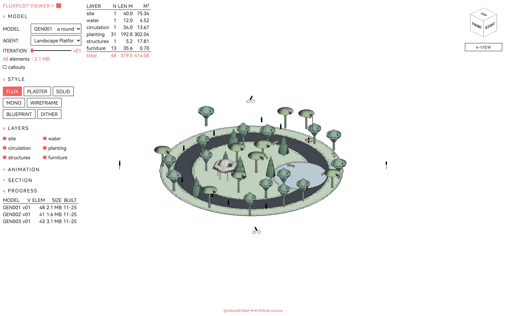

# Landscape Agent Platform

Natural language → inspectable parameter spec → parametric landscape geometry, with optional viewer preview and OBJ / DAE / 3DM export.

A research prototype from IFLA 2026 abstract #767 (*Sub-theme 8: Pedagogies of Flux*). It is not a production design tool, and it makes no claim that the generated geometry is botanically, ecologically or constructionally correct. What it does claim is that every generated model can be traced back to the parsed `spec` — which is the whole point of using it in a studio.

> 中文说明见文末 [中文](#中文).



*Prompt: "a round park with a pond, a loop road, a pavilion and 30 trees" → 48 elements, 0.5 m grid classification (site / water / circulation / planting / structures / furniture), exportable as OBJ, DAE or 3DM.*

## Quick start

Python ≥ 3.7, **no third-party dependency required**.

```bash
python app.py            # Windows: double-click run_platform.bat
# open http://localhost:8400
```

Type a brief, for example:

```
a square park with a water basin, a circular plaza, cross paths and rows of trees
```

or in Chinese:

```
一个带环形道路和两个亭子的生态公园
```

You get back an `id`, the parsed `spec` (JSON), an element table, and the model file path.


## Optional dependencies

| Package | Unlocks | Without it |
|---|---|---|
| `shapely` | analytic road geometry (loop offset, rectangle intersection) | falls back to raster roads |
| `rhino3dm` | `.3dm` export | OBJ / DAE only |

```bash
pip install -r requirements.txt
```

## Optional: FluxPlot viewer

The `/viewer/` route expects a copy of the [CraftBot](https://github.com/lukapiskorec/craftbot) viewer (MIT). **Its code and model library are not bundled here.** Point the app at your copy:

```bash
set CRAFTBOT_VIEWER=D:\path\to\craftbot\viewer      # Windows
export CRAFTBOT_VIEWER=/path/to/craftbot/viewer     # macOS / Linux
```

or drop it at `vendor/craftbot/viewer/`. Without a viewer the platform still generates and exports; `viewer_url` is `null` and `/viewer/` returns 404.

## How it works

```text
prompt
  └─ nl_parser.py   semantic layer: regex + keyword rules (Claude if ANTHROPIC_API_KEY is set, with automatic fallback)
       → spec JSON: site size/shape, roads, plaza, water, green ratio, structures, style
  └─ generator.py   execution layer: 0.5 m grid, cls_at(x,y) with priority water > plaza > road > green
       → boundary subdivision into watertight slabs → craftbot-model JSON
  └─ exporter.py    OBJ / DAE (SketchUp-importable) / 3DM
  └─ analytics.py   aggregate logs/generations.jsonl into coverage and field-hit reports
```

The split between "semantic parsing" and "geometry generation" is deliberate: the intermediate `spec` is meant to be inspected, argued with and edited by students, which is exactly the auditable-generation angle in the paper.

## Layout

```text
app.py            local HTTP server (standard library, no framework)
nl_parser.py      semantic layer: natural language → spec
generator.py      execution layer: spec → craftbot-model JSON
exporter.py       OBJ / DAE / 3DM export
analytics.py      generation-log reports
selftest.py       29 prompt cases + API smoke
styles.json       style presets
static/index.html browser UI
run_platform.bat  one-click start on Windows
docs/             screenshots
```

Runtime output (`models/`, `logs/`, `exports/`) is created on first run and is git-ignored.

## API

| Method | Path | Description |
|---|---|---|
| GET | `/api/health` | viewer present, 3DM available, analytic roads enabled |
| POST | `/api/generate` | `{"prompt": "...", "fine": false}` → spec + stats + model id |
| GET | `/api/models` | generated models |
| GET | `/api/export?id=GEN001&fmt=obj` | `fmt` = `obj` / `dae` / `3dm` |
| GET | `/api/analytics` | aggregated generation log |

## Self-test

```bash
python selftest.py --no-api     # parser + generator only
python selftest.py              # plus HTTP API smoke test
```

## Research context

The platform supports the paper's studio workflow: students generate planting and layout variants from a brief, then audit the generated results against schedules, renders and analysis boards. The paper's finding is that fluent generation does not imply verifiable output, so this repository deliberately exposes the intermediate parameters and exports rather than promising "correct" designs.

Citation metadata: [CITATION.cff](CITATION.cff).

## License

MIT, see [LICENSE](LICENSE). The browser UI takes layout and colour cues from FluxPlot / [CraftBot](https://github.com/lukapiskorec/craftbot) (Luka Piškorec, MIT); no CraftBot code or assets are redistributed. See [NOTICE](NOTICE).

---

## 中文

自然语言 → 可检查的参数规格 → 参数化景观几何，可选查看器预览，导出 OBJ / DAE / 3DM。

这是 IFLA 2026 摘要 #767（Sub-theme 8: Pedagogies of Flux）配套的研究原型。它不是生产级设计工具，也不声称生成结果在植物学、生态或施工层面正确；它保证的是**每个模型都能追溯回解析出的 `spec`**——这正是它在教学里可用的原因。


*提示词："a round park with a pond, a loop road, a pavilion and 30 trees" → 48 个元素，0.5 m 栅格分类（场地／水体／道路／种植／构筑／家具），可导出 OBJ、DAE、3DM。*

### 30 秒跑起来

需要 Python ≥ 3.7，**核心零第三方依赖**。

```bash
python app.py            # 或双击 run_platform.bat（Windows）
# 打开 http://localhost:8400
```

输入一句描述，例如 `一个带环形道路和两个亭子的生态公园`，返回模型 id、解析出的 spec、元素统计与可选导出。

### 可选依赖

| 包 | 作用 | 没装时 |
|---|---|---|
| `shapely` | 解析式道路（环路偏移、矩形相交） | 回落到栅格道路 |
| `rhino3dm` | 导出 `.3dm` | 仅 OBJ / DAE |

### 可选：FluxPlot 查看器

`/viewer/` 需要一个 [CraftBot](https://github.com/lukapiskorec/craftbot)（MIT）的 viewer 副本，本项目**不打包**其代码与模型库。用环境变量指定位置：

```bash
set CRAFTBOT_VIEWER=D:\path\to\craftbot\viewer
```

或放到 `vendor/craftbot/viewer/`。没有查看器时，生成与导出照常可用，`viewer_url` 返回 `null`。

### 许可

MIT，见 [LICENSE](LICENSE)；界面视觉参考 FluxPlot / CraftBot，见 [NOTICE](NOTICE)。
