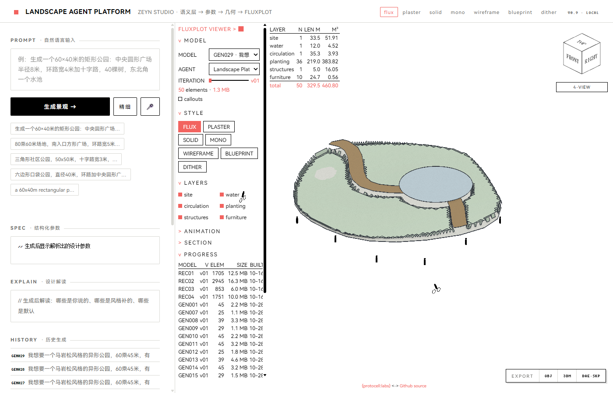

# Landscape Agent Platform · 景观生成平台

自然语言 → 结构化参数 → 景观几何 →（可选）FluxPlot 预览与 3DM / OBJ / DAE 导出。

这是 IFLA 2026 摘要 #767（Sub-theme 8: *Pedagogies of Flux*）配套的原型代码，用来演示"把一句中文/英文描述翻译成可检查的参数规格，再生成可导出的场地几何"这一条链路。它是一个**研究原型**，不是生产级设计工具，也不声称生成结果在植物学、生态或施工层面正确。

> A small research prototype: natural-language description → inspectable parameter spec → parametric landscape geometry (grid-classified site plan) → optional viewer preview and OBJ/DAE/3DM export.



## 30 秒跑起来

需要 Python ≥ 3.7，**核心零第三方依赖**。

```bash
python app.py            # 或双击 run_platform.bat（Windows）
# 打开 http://localhost:8400
```

输入一句描述，例如：

```
一个生态的小公园，有环状道路和两个亭子，绿地多一点
```

返回：`id`、解析出的 `spec`（JSON）、元素统计，以及模型文件路径。

### 可选依赖（装了自动启用）

| 包 | 作用 | 没装时 |
|---|---|---|
| `shapely` | 解析式道路（环路偏移、矩形相交） | 回落到栅格道路 |
| `rhino3dm` | 导出 `.3dm` | 只支持 OBJ / DAE |

```bash
pip install -r requirements.txt
```

### 可选：接入 FluxPlot 查看器

`/viewer/` 路由需要一个 [CraftBot](https://github.com/lukapiskorec/craftbot) 的 viewer 副本（MIT，本项目**不打包**其代码或模型库）。任选一种：

```bash
set CRAFTBOT_VIEWER=D:\path\to\craftbot\viewer      # Windows
export CRAFTBOT_VIEWER=/path/to/craftbot/viewer     # macOS / Linux
```

或把它放到 `vendor/craftbot/viewer/`。没有查看器时，平台仍能生成与导出，只是 `viewer_url` 返回 `null`、`/viewer/` 返回 404。

## 它是怎么工作的

```text
prompt
  └─ nl_parser.py   语义层：正则 + 关键词规则（设 ANTHROPIC_API_KEY 时改用 Claude，失败自动回落）
       → spec JSON：场地尺寸/道路/广场/水体/绿地比例/构件数量/风格
  └─ generator.py   执行层：0.5 m 栅格分类 cls_at(x,y)，优先级 水 > 广场 > 路 > 绿地
       → 边界细分成水密薄板 → craftbot-model JSON
  └─ exporter.py    导出：OBJ / DAE（SketchUp 可导）/ 3DM（rhino3dm）
  └─ analytics.py   把 logs/generations.jsonl 汇总成覆盖率与字段命中率报告
```

设计上刻意把"语义解析"与"几何生成"分开，让中间产物 `spec` 可以被学生逐项检查、质疑和修改——这正是论文里"可审计的生成"的教学落点。

## 目录

```text
app.py            本地 HTTP 服务（标准库，无框架）
nl_parser.py      语义层：自然语言 → spec
generator.py      执行层：spec → craftbot-model JSON
exporter.py       OBJ / DAE / 3DM 导出
analytics.py      生成日志的汇总报告
selftest.py       自检：29 组提示词 + API 冒烟
styles.json       风格预设
static/index.html 浏览器界面
run_platform.bat  Windows 一键启动
docs/             截图
```

运行时会在仓库根目录生成 `models/`（生成结果与 `index.json`）、`logs/`（`generations.jsonl`、`devlog.md`）、`exports/`；三者均已加入 `.gitignore`。

## API

| 方法 | 路径 | 说明 |
|---|---|---|
| GET | `/api/health` | 健康检查（查看器是否存在、3DM 是否可用、是否启用解析式道路） |
| POST | `/api/generate` | `{"prompt": "...", "fine": false}` → spec + 统计 + 模型 id |
| GET | `/api/models` | 已生成模型列表 |
| GET | `/api/export?id=GEN001&fmt=obj` | `fmt` = `obj` / `dae` / `3dm` |
| GET | `/api/analytics` | 生成日志汇总 |

## 自检

```bash
python selftest.py --no-api     # 只跑解析 + 生成
python selftest.py              # 追加 HTTP API 冒烟
```

## 研究背景

平台用于论文中"agent 辅助种植/景观设计"的教学场景：学生用自然语言描述生成方案，再回过来审计生成结果与种植表、渲染、分析板之间的一致性。论文的结论是**生成的流畅不等于可验证**，因此本仓库只提供"生成 + 可导出的中间参数"，不提供任何"结果正确"的保证。

引用格式见 [CITATION.cff](CITATION.cff)。

## 许可

MIT，见 [LICENSE](LICENSE)。
界面视觉参考了 [FluxPlot / CraftBot](https://github.com/lukapiskorec/craftbot)（Luka Piškorec，MIT）的布局与配色，见 [NOTICE](NOTICE)；本项目未包含其代码与模型库。
